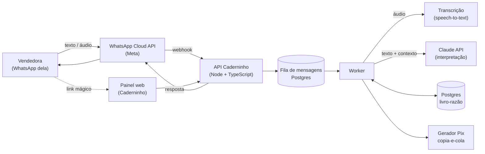
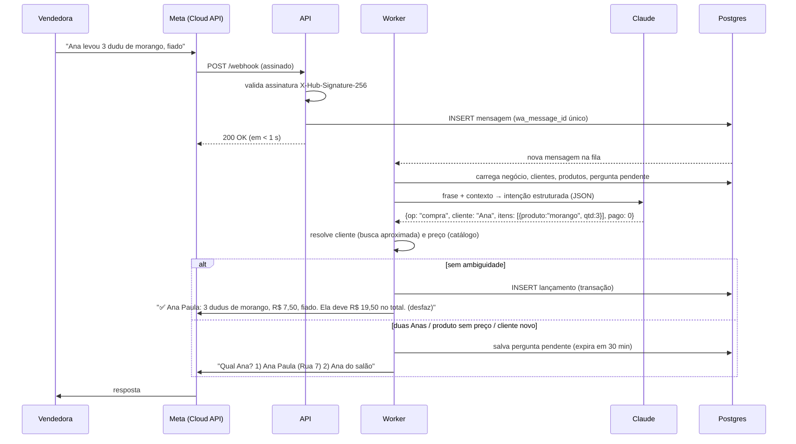
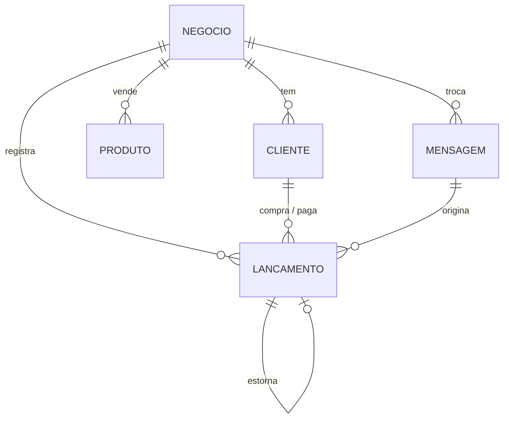

# Caderninho no WhatsApp: plano e system design do protótipo

> **Novidade:** o robô também responde **"estou tendo lucro?"**. Com o custo de cada produto e as contas fixas do mês, ele calcula a margem de contribuição e o ponto de equilíbrio (seção 10). O painel ganhou a tela **Lucro** com a mesma conta.
>
> **Mudança de rumo em relação ao `app/index.html`.** A entrada principal deixa de ser um app com formulários. Agora é **um número de WhatsApp** com quem a vendedora conversa do jeito que já conversa hoje ("Ana levou 3 dudu de morango, fiado"). O app web vira o **painel**: um link para ver a lista de quem deve quanto.

---

## 1. Objetivo do protótipo

Validar uma única hipótese com uma única usuária (a amiga dos dudus):

> **Se anotar no WhatsApp com um robô for tão fácil quanto mandar mensagem pra si mesma, ela larga a conversa de anotações e o caderno.**

Critérios de sucesso, medidos depois de 4 semanas de piloto:

| Métrica | Meta |
|---|---|
| Vendas a fiado anotadas pelo robô (contra o total real, conferido com ela toda semana) | ≥ 90% |
| Erros silenciosos (registro errado que ela não percebeu na confirmação) | 0 |
| Correções ("desfaz", "não, era a outra Ana") | < 10% das mensagens |
| Tempo da mensagem até a confirmação, p95 | < 5 s em texto, < 10 s em áudio |
| Cobranças geradas com "cobra a X" | ≥ 1 por semana |
| Ela informou o custo dos produtos e as contas fixas, e consultou "como tá o mês?" | ≥ 1 vez por semana a partir da semana 2 |
| Ela continua usando na semana 4 sem ser lembrada | sim |

**Fora do escopo do protótipo:** agenda e serviços (refrigeração), envio automático de mensagens para os clientes dela, conciliação automática de Pix, cobrança da assinatura, vários usuários por negócio.

---

## 2. Princípios de design

1. **O WhatsApp é a interface.** Nada de cadastro antes do uso. A primeira mensagem já funciona.
2. **O LLM interpreta, o servidor decide.** O modelo só transforma a frase em uma intenção estruturada. Quem procura o cliente, calcula o preço, grava e escreve os números da confirmação é código determinístico. **O LLM nunca escreve um valor que vai para a usuária.**
3. **Toda escrita gera confirmação.** Cada registro volta com quem, o quê, quanto e o saldo novo. Se houver dúvida, o robô pergunta antes de gravar.
4. **Livro-razão só de acréscimo.** Lançamentos nunca são editados nem apagados. Correção é um novo lançamento de estorno. Isso dá histórico auditável e torna o "desfaz" trivial.
5. **O robô só conversa com a dona do negócio.** Ele nunca manda mensagem para os clientes dela. A cobrança sai pronta para ela encaminhar. Isso mantém o custo da API do WhatsApp perto de zero e elimina o risco de spam.
6. **Dinheiro em centavos inteiros.** Nunca `float`.

---

## 3. Visão geral



Um único serviço (API + worker no mesmo processo) e um banco Postgres. Nada de microserviços no protótipo.

---

## 4. Fluxo de uma mensagem



Detalhes importantes:

- **Responder 200 ao webhook imediatamente** e processar depois. A Meta reenvia o webhook se demorar ou falhar. Por isso `wa_message_id` é `UNIQUE`, e reprocessar a mesma mensagem não duplica nada (idempotência).
- **Ordem por remetente.** Mensagens da mesma vendedora são processadas em sequência (lock por `negocio_id`), para que "Ana levou 3" e logo depois "desfaz" não se cruzem.
- **"Digitando…"** O worker marca a mensagem como lida assim que a pega, para ela ver que chegou.

---

## 5. Interpretação com LLM

### 5.1 Por que uma chamada só, e não um agente com várias ferramentas

O desenho ingênuo dá ao modelo ferramentas como `buscar_cliente`, `registrar_compra` e `consultar_saldo` e deixa ele encadear as chamadas. Funciona, mas cada mensagem vira 2 ou 3 idas ao modelo, e quem escolhe o cliente é o modelo.

No protótipo, **cada mensagem gera uma chamada** com saída estruturada (`output_config.format` com JSON Schema). O modelo devolve uma lista de operações, e o servidor executa:

```jsonc
{
  "operacoes": [
    {
      "tipo": "compra",                 // compra | pagamento | consulta_saldo | listar_devedores
                                        // | cobrar | desfazer | cadastrar_produto | painel | ajuda | nao_entendi
      "cliente_texto": "Ana",           // como a vendedora escreveu
      "cliente_id_sugerido": "c_81",    // se o modelo reconheceu na lista do contexto; o servidor confere
      "itens": [{ "produto_texto": "dudu de morango", "produto_id_sugerido": "p_3", "quantidade": 3 }],
      "valor_centavos_informado": null, // só quando ela falou o valor ("pagou 10 conto")
      "pago_agora_centavos": 0,
      "forma": null,                    // pix | dinheiro | cartao
      "data_relativa": null             // "ontem", "sexta"; o servidor converte
    }
  ],
  "resposta_a_pergunta_pendente": null  // "1", "a da rua 7"…
}
```

Assim:

- **Cálculo, busca e gravação são código testável.** O modelo faz o que faz bem: entender "3 dudu de moranguinho pra Aninha, ela paga sexta".
- **Uma mensagem pode ter várias operações** ("Ana levou 2, Bia levou 3 e o Josué pagou 20").
- O custo e a latência caem para uma chamada por mensagem.
- As operações continuam modeladas como "tools" no código (`registrarCompra()`, `registrarPagamento()`…). Mais tarde elas podem ser expostas por **MCP** para quem usa Claude ou outro assistente, sem mudar nada no núcleo.

### 5.2 Contexto enviado ao modelo

Em ordem, para aproveitar o cache de prompt (o prefixo estável primeiro):

1. **Instruções fixas** (system prompt): papel, gírias e regras ("fiado", "pendura", "anota", "pagou", "acertou", "conto" = reais), exemplos de frases reais e o formato de saída. → *ponto de cache*
2. **Catálogo e clientes do negócio**: nome, apelidos e id (para um negócio de bairro, de 50 a 300 linhas). Muda pouco. → *ponto de cache*
3. **Estado da conversa**: a pergunta pendente, se houver, e as últimas 3 trocas.
4. **A mensagem nova** (texto ou transcrição do áudio) e a data de hoje.

Nunca vai para o modelo: saldos, telefones, chave Pix. Ele não precisa disso para interpretar.

### 5.3 Modelo e custo

| | Claude Opus 5.5 (`claude-opus-5-5`) | Claude Haiku 5.5 (`claude-haiku-5-5`) |
|---|---|---|
| Preço (entrada / saída, por milhão de tokens) | US$ 4 / US$ 20 (leitura de cache US$ 0,20) | US$ 0,10 / US$ 0,50 |
| Custo estimado por mensagem* | ~US$ 0,006 a 0,01 | ~US$ 0,0003 |
| 60 mensagens/dia por 30 dias | ~US$ 11 a 18/mês | ~US$ 0,50/mês |

\* Estimativa: ~3 mil tokens de contexto (a maior parte em cache), ~400 tokens novos e ~250 de saída. Medir de verdade com `usage` no piloto.

**Recomendação:** começar o piloto com **Opus 5.5 em `effort: "low"`** para estabelecer a qualidade de referência, enquanto o conjunto de testes (seção 11) é montado. Depois rodar o mesmo conjunto no **Haiku 5.5**. Se ele acertar tanto quanto, a troca derruba o custo do LLM a centavos por cliente por mês, o que importa para um produto vendido a microempreendedor. A decisão é sua, com os números na mão.

Notas técnicas para esses modelos:
- Use saída estruturada (`output_config.format`) em vez de forçar uma tool: `tool_choice` forçado (`any`/`tool`) é recusado no Opus 5.5.
- No Opus 5.5 o raciocínio não pode ser desligado. O controle é `effort` (o padrão é `medium`; para essa tarefa, `low`).
- Trate `stop_reason: "refusal"` e `max_tokens` antes de ler a resposta. Nesses casos responda "não entendi, pode repetir?" e não grave nada.

### 5.4 Áudio

A API do Claude não recebe áudio. Fluxo: baixar a mídia pela Graph API (`GET /{media_id}` → URL → download com o token) → transcrever com um serviço de speech-to-text que funcione bem em pt-BR (Whisper/gpt-4o-transcribe, Groq Whisper ou Google STT; o custo fica em frações de centavo por áudio curto) → seguir pelo mesmo caminho do texto. A confirmação mostra o que foi entendido ("🎙️ Entendi: *Ana levou três dudu de morango*"), porque erro de transcrição em nome próprio é comum.

---

## 6. Regras de resolução (o código que protege a confiança)

| Situação | Comportamento |
|---|---|
| Um cliente bate com o nome (exato, apelido ou aproximado com alta confiança) | Grava e confirma |
| Dois ou mais candidatos | Pergunta com opções numeradas; nada é gravado até a resposta |
| Nenhum candidato | "Não achei *Aninha*. É cliente nova? (sim / é a Ana Paula)" |
| Produto sem preço e sem valor informado | "Quanto custa o dudu de açaí? Vou guardar o preço." |
| Valor informado diferente do catálogo ("3 dudu por 5 reais") | Vale o informado; a confirmação deixa isso explícito |
| Pagamento maior que a dívida | Confirma e registra o crédito: "Ela ficou com R$ 2 de crédito" |
| Valor fora do normal (10× a média dela) | Pergunta antes: "R$ 300 mesmo?" |
| "desfaz" / "cancela a última" | Estorna o último lançamento dela (até 24 h) e confirma o saldo |
| Pergunta pendente sem resposta em 30 min | Expira; a próxima mensagem é tratada como nova |

A busca aproximada usa `unaccent` + `pg_trgm` no Postgres, mais a tabela de apelidos que **aprende com as respostas**: se ela respondeu que "Aninha" é a Ana Paula, "Aninha" vira apelido da Ana Paula.

---

## 7. Modelo de dados



```sql
create table negocio (
  id            uuid primary key default gen_random_uuid(),
  wa_id_dono    text not null unique,          -- telefone de quem fala com o robô
  nome          text not null,
  pix_chave     text, pix_nome text, pix_cidade text,
  fuso          text not null default 'America/Recife',
  meta_lucro_centavos bigint,                    -- quanto quer lucrar por mês (opcional)
  criado_em     timestamptz not null default now()
);

create table cliente (
  id          uuid primary key default gen_random_uuid(),
  negocio_id  uuid not null references negocio(id),
  nome        text not null,
  apelidos    text[] not null default '{}',
  telefone    text,                              -- opcional
  limite_centavos bigint,                        -- opcional
  arquivado   boolean not null default false,
  criado_em   timestamptz not null default now()
);
create index on cliente using gin (nome gin_trgm_ops);

create table produto (
  id             uuid primary key default gen_random_uuid(),
  negocio_id     uuid not null references negocio(id),
  nome           text not null,
  apelidos       text[] not null default '{}',
  preco_centavos bigint not null check (preco_centavos >= 0),
  custo_centavos bigint check (custo_centavos >= 0), -- custo variável por unidade; null = não informado
  ativo          boolean not null default true
);

create type tipo_lancamento as enum ('compra', 'pagamento', 'estorno', 'ajuste');

create table lancamento (                        -- só INSERT; nunca UPDATE/DELETE
  id              uuid primary key default gen_random_uuid(),
  negocio_id      uuid not null references negocio(id),
  cliente_id      uuid not null references cliente(id),
  tipo            tipo_lancamento not null,
  valor_centavos  bigint not null,               -- + aumenta a dívida, − diminui
  pago_na_hora_centavos bigint not null default 0, -- compra: quanto já foi pago no ato
  itens           jsonb,                         -- [{produto_id, nome, qtd, preco_centavos, custo_centavos}]
                                                 -- o custo é copiado do produto no dia da venda: mudar o custo depois não reescreve o passado
  forma           text,                          -- pix | dinheiro | cartao
  ocorreu_em      date not null,
  estorna_id      uuid references lancamento(id),
  mensagem_id     uuid references mensagem(id),  -- de onde veio (auditoria)
  origem          text not null default 'whatsapp', -- whatsapp | painel
  criado_em       timestamptz not null default now()
);
create index on lancamento (negocio_id, cliente_id, ocorreu_em);

create view saldo_cliente as
  select cliente_id, sum(valor_centavos) as saldo_centavos
  from lancamento group by cliente_id;

create table custo_fixo (                       -- contas do mês que não dependem de vender
  id             uuid primary key default gen_random_uuid(),
  negocio_id     uuid not null references negocio(id),
  nome           text not null,                  -- luz do freezer, celular, aluguel, MEI
  valor_centavos bigint not null check (valor_centavos >= 0),
  vigente_desde  date not null default current_date,
  vigente_ate    date                            -- mudou de valor: fecha a linha e abre outra
);

create table mensagem (
  id             uuid primary key default gen_random_uuid(),
  negocio_id     uuid references negocio(id),
  wa_message_id  text unique,                    -- idempotência do webhook
  direcao        text not null,                  -- entrada | saida
  tipo           text not null,                  -- texto | audio | botao
  conteudo       text, transcricao text,
  interpretacao  jsonb,                          -- saída do LLM (para depurar e avaliar)
  status         text not null default 'pendente',
  criado_em      timestamptz not null default now()
);

create table pergunta_pendente (
  negocio_id   uuid primary key references negocio(id),
  operacao     jsonb not null,                   -- operação aguardando resposta
  opcoes       jsonb not null,
  expira_em    timestamptz not null
);
```

O mesmo esquema serve para geladinho, marmita, manicure, diarista e cantina. O que muda de um negócio para outro é só a tabela `produto`, que é opcional.

**Convenção de sinal:** uma compra de R$ 10 com R$ 4 pagos na hora vira um lançamento `compra` com `valor_centavos = +600` (só a parte que ficou devendo) e `pago_na_hora_centavos = 400` e `itens` completos (para o extrato mostrar a compra inteira). Pagamento é `−`. Estorno é o negativo do lançamento estornado. O saldo é sempre `sum(valor_centavos)`.

---

## 8. Comandos que a vendedora usa (exemplos, não sintaxe)

| Ela escreve ou fala | O que acontece |
|---|---|
| "Ana levou 3 de morango fiado" | Compra no fiado + confirmação com o saldo |
| "Bia pegou 5, pagou 2 no pix" | Compra com parte paga |
| "Josué pagou 20" / "o Josué acertou" | Pagamento (parcial ou total); "acertou" quita o saldo inteiro |
| "Quanto a Ana deve?" | Saldo + extrato curto |
| "Quem tá devendo?" | Lista ordenada por valor e por tempo |
| "Cobra a Ana" | Gera a mensagem de cobrança (seção 9) |
| "Desfaz" | Estorna o último lançamento |
| "Dudu de açaí agora é 3 reais" | Cria ou atualiza produto |
| "Custo do dudu de morango é 85 centavos" | Grava o custo e responde a margem: "Margem de R$ 1,65 por dudu (66%)" |
| "Luz do freezer dá uns 90 por mês" | Cria ou atualiza um custo fixo |
| "Como tá o mês?" / "Quanto falta pra empatar?" | Ponto de equilíbrio, quanto falta (em R$ e em unidades) e resultado até agora (seção 10) |
| "Se eu vender o dudu a 3 reais?" | Simulação: nova margem e quantas unidades precisa vender |
| "Painel" / "manda o link" | Envia o link mágico do painel |

Na primeira mensagem de um número desconhecido acontece um onboarding de 3 perguntas: nome do negócio, chave Pix e cidade (a cidade vai no Pix). No piloto, só números de uma lista permitida são atendidos.

---

## 9. Cobrança: onde está o valor

"Cobra a Ana" gera **duas mensagens**:

1. Para ela: "Aqui está a cobrança da Ana Paula (R$ 19,50). Encaminhe a próxima mensagem para ela, ou toque no link para abrir a conversa com o texto pronto: wa.me/55…?text=…" (o link só aparece se o telefone da cliente estiver cadastrado).
2. A cobrança em si, escrita para ser encaminhada:

```
Oi, Ana! Tudo bem? 😊
Passando pra lembrar do que ficou anotado aqui nos Dudus da Vila:
• 30/10: 6 dudu ninho + 4 morango (R$ 28,00)
• 06/11: pacote 10 dudus (R$ 22,00)
Já pago: R$ 30,50
Total em aberto: R$ 19,50

Pix copia e cola (já com o valor):
00020126...6304ABCD
```

- O **Pix copia-e-cola** é um BR Code estático (padrão EMV do Banco Central) gerado localmente: chave, nome, cidade, valor e identificador, com CRC16 no final. Não precisa de banco nem de intermediador.
- Encaminhar mostra o rótulo "Encaminhada" no WhatsApp. O link `wa.me` com texto evita o rótulo. As duas opções ficam disponíveis.
- O texto é um modelo fixo preenchido pelo servidor, não gerado pelo LLM, então os valores são sempre exatos.
- **Depois do piloto:** confirmação automática do Pix pelo webhook de um banco (por exemplo, uma conta PJ com API de Pix), e o pagamento cai sozinho no livro-razão.

---

## 10. Lucro: o ponto de equilíbrio dentro da conversa

Anotar e cobrar respondem "quem me deve". A próxima pergunta de quem vende é **"estou ganhando dinheiro?"**. A conta é a mesma de qualquer aula de precificação, aplicada aos dados que o Caderninho já tem:

| Conceito | Fórmula | Exemplo (lata comprada a R$ 2,99 e vendida a R$ 8, com R$ 1.000 de fixos) |
|---|---|---|
| Margem de contribuição | (preço − custo) ÷ preço | (8,00 − 2,99) ÷ 8,00 = **62,6%** |
| Ponto de equilíbrio (R$) | custos fixos ÷ margem | 1.000 ÷ 0,626 = **R$ 1.596,81** |
| Unidades para empatar | ponto de equilíbrio ÷ preço | 1.596,81 ÷ 8 ≈ **200 unidades** |
| Faturamento para a meta de lucro | (fixos + lucro desejado) ÷ margem | com meta de R$ 500: 1.500 ÷ 0,626 = R$ 2.395 |
| Preço para uma margem desejada | custo ÷ (1 − margem desejada) | custo R$ 2,99 e margem de 60% → R$ 7,48 |

### O que o Caderninho faz diferente de uma planilha

- **Usa as vendas reais.** A planilha pede um preço; o negócio vende vários produtos. A margem usada é a **média ponderada do que foi vendido no mês** (receita menos o custo dos itens vendidos, dividido pela receita), e as unidades para empatar usam o preço médio por unidade vendida.
- **Atualiza sozinho.** Cada venda anotada move a barra até o ponto de equilíbrio. Ninguém precisa abrir planilha no fim do mês.
- **Separa lucro de dinheiro no bolso.** Venda no fiado entra no faturamento, mas não no caixa. A resposta mostra as duas coisas: "você já passou do empate, mas R$ 340 desse mês estão no fiado". Fiado que não volta é prejuízo, e isso liga a conta do lucro à cobrança (seção 9).
- **Custo congelado na venda.** O custo de cada item é copiado para o lançamento. Se o leite ninho subir em dezembro, a margem de novembro continua certa.

### Como o robô responde

Tudo calculado no servidor, com texto montado por modelo fixo (princípio 2: o LLM não escreve números):

```
📊 Novembro até hoje (dia 21)
Vendido: R$ 158,50 · margem de 63%
Contas fixas: R$ 200,00
Ponto de equilíbrio: R$ 318,91 (≈ 76 dudus no mês)

Faltam R$ 160,41 pra empatar (≈ 38 dudus em 9 dias, uns 5 por dia).
⚠️ R$ 75,00 das vendas estão no fiado. "cobra a Ana" ajuda a fechar o mês.
```

### Coleta dos números sem formulário

- Custos e contas fixas **não entram no onboarding**. O registro de vendas funciona sem eles.
- Depois de 5 vendas, o robô pergunta uma vez: "Quer saber se está tendo lucro? Me diz quanto custa fazer cada dudu (ingredientes + saquinho)". A partir da resposta ("o de morango sai uns 85 centavos"), ele grava o custo.
- Contas fixas também são frases: "luz do freezer uns 90", "celular 50". Valor mensal aproximado basta.
- Quando falta custo de algum produto, a resposta avisa e usa a margem média dos outros, deixando claro que é estimativa.

### Limites que a resposta deixa explícitos

- É uma **estimativa de gestão**, não contabilidade. Não substitui o contador nem trata impostos além do que ela colocar como custo fixo (por exemplo, o DAS do MEI).
- No custo por unidade entra tudo que acompanha cada venda: ingredientes, embalagem, gás, peças e a **taxa da maquininha** quando a venda é no cartão.
- Com produtos muito diferentes (pacote de 10 contra unidade avulsa), "unidades para empatar" é aproximado. O valor em reais é o número confiável.

## 11. Avaliação: como saber se está funcionando antes de dar pra ela

1. **Conjunto de frases reais.** Com permissão dela, exportar a conversa de anotações que ela já usa e montar de 100 a 200 frases com a interpretação esperada. Somar casos difíceis: duas Anas, erro de digitação, gíria, várias operações numa frase, áudio transcrito com erro.
2. **Teste automático** que roda o interpretador nessas frases e compara com o esperado: tipo da operação, cliente, quantidades e valores. Roda a cada mudança no prompt ou no modelo.
3. **Testes unitários do núcleo:** cálculo de saldo, estorno, margem e ponto de equilíbrio (incluindo o exemplo da tabela da seção 10, que precisa dar 62,6%, R$ 1.596,81 e 200 unidades), busca aproximada, geração do Pix (validado contra um leitor de BR Code) e idempotência do webhook.
4. **Durante o piloto:** revisão semanal de 15 minutos com ela comparando o painel com a realidade. Toda divergência vira um caso novo no conjunto de testes.

---

## 12. Stack e infraestrutura

| Peça | Escolha para o protótipo | Por quê |
|---|---|---|
| Linguagem | TypeScript (Node 22) | Uma linguagem para servidor e painel; SDK oficial da Anthropic e boas bibliotecas para a Graph API |
| HTTP | Hono ou Fastify | Leve, simples para o webhook |
| Banco | Postgres gerenciado (Supabase ou Neon, plano gratuito) | `pg_trgm`/`unaccent` para busca aproximada; transações para o livro-razão |
| Fila | Tabela no próprio Postgres (`FOR UPDATE SKIP LOCKED`) ou pg-boss | Sem Redis para manter; volume minúsculo |
| Hospedagem | Um container (Fly.io, Railway ou Render) | Um serviço, deploy por git push |
| WhatsApp | WhatsApp Business Platform, **Cloud API oficial** | Sem risco de banimento do número |
| LLM | Claude API com saída estruturada (seção 5.3) | |
| Transcrição | Serviço de STT com bom pt-BR | Claude não recebe áudio |
| Painel | O `app/index.html` atual adaptado para ler da API | Já existe e já foi testado |
| Segredos | Variáveis de ambiente do provedor | Token da Meta, chave da Anthropic, chave do STT, segredo do link mágico |

### WhatsApp: números e custo

- **Piloto:** a Meta fornece um **número de teste** gratuito no app de desenvolvedor, que conversa com até 5 números cadastrados. Isso basta para ela e para você.
- **Produção:** um número dedicado ao robô (um chip novo que não esteja no app WhatsApp), perfil do negócio e verificação da empresa na Meta para tirar os limites.
- **Custo:** respostas dentro da janela de 24 h aberta por uma mensagem dela são mensagens de serviço, sem custo na tabela atual da Meta. Como o robô só responde à dona do negócio, o custo da Meta tende a zero. O que cobra é mensagem iniciada pelo robô fora da janela (por exemplo, um "resumo de segunda-feira"), que exige template aprovado e é cobrada por mensagem. **Confirme a tabela vigente para o Brasil antes de definir o preço do produto.**
- **Não usar** bibliotecas não oficiais que automatizam o WhatsApp Web: violam os termos e o número pode ser banido.

---

## 13. Painel web

- O robô manda um **link mágico** (`/p/<token>`): um token assinado com HMAC que contém `negocio_id` e validade de 7 dias. Não tem senha.
- O protótipo do painel é **somente leitura**: total na rua, quem deve quanto e há quanto tempo, extrato por cliente, um botão "Cobrar" que gera a mesma mensagem da seção 9 e a tela **Lucro** (seção 10), com a barra até o ponto de equilíbrio, a margem de cada produto e o simulador de preço.
- Correções continuam pelo WhatsApp ("desfaz") no protótipo. Edição pelo painel fica para depois (com `origem = 'painel'` no lançamento).

---

## 14. Segurança e LGPD

- **Papéis:** a vendedora é a controladora dos dados dos clientes dela; o Caderninho é o operador. Termo de uso simples aceito no onboarding.
- **Mínimo de dados:** nome e, opcionalmente, telefone dos clientes. Nada de CPF.
- **Para o LLM vai só o necessário** (nomes, apelidos e produtos), sem saldos nem telefones. A API da Anthropic não usa dados de API para treinar modelos por padrão.
- Validação da assinatura do webhook (`X-Hub-Signature-256`) e lista de números permitidos no piloto.
- Banco com criptografia em repouso (padrão dos provedores) e backup diário.
- **Exportar e apagar:** "manda meus dados" gera um CSV; "apaga minha conta" remove tudo após confirmação.
- Áudios baixados são descartados depois da transcrição. Fica só o texto.

---

## 15. Plano de execução

| Fase | Duração | Entregas | Pronto quando |
|---|---|---|---|
| **0. Fundação** ✅ feita (`server/`) | 3 a 4 dias | App na Meta com número de teste; webhook com validação de assinatura que responde "eco"; Postgres com o esquema; deploy | Ela manda "oi" e recebe resposta |
| **1. Registrar e consultar (texto)** | 1,5 semana | Interpretador com saída estruturada; busca aproximada; compra, pagamento, saldo, devedores e desfaz; perguntas de desambiguação; confirmações; conjunto de testes com ≥ 100 frases | ≥ 95% de acerto no conjunto de testes e nenhum registro sem confirmação |
| **2. Áudio, cobrança e painel** | 1 semana | Transcrição; "cobra a X" com Pix copia-e-cola; link mágico; painel somente leitura | Pix gerado é lido pelo app do banco com o valor certo |
| **2b. Lucro** | 3 a 4 dias | Custo por produto e contas fixas por mensagem; "como tá o mês?"; simulação de preço; tela Lucro no painel | O exemplo da seção 10 bate centavo por centavo nos testes |
| **3. Piloto** | 4 semanas | Uso real pela amiga; revisão semanal; correções | Métricas da seção 1 |
| **4. Decisão** | — | Relato do piloto (números + falas dela) | Continuar, ajustar ou parar |

Total até o início do piloto: **cerca de 3,5 semanas** de uma pessoa desenvolvendo em meio período.

### Custo mensal estimado durante o piloto (1 usuária)

| Item | Custo |
|---|---|
| Hospedagem + Postgres (planos gratuitos ou de entrada) | US$ 0 a 10 |
| WhatsApp Cloud API (só respostas dentro da janela) | ~US$ 0 |
| Claude (Opus 5.5 a ~60 mensagens/dia) | ~US$ 11 a 18 |
| Transcrição (~20 áudios curtos/dia) | < US$ 2 |
| **Total** | **~US$ 15 a 30/mês** (cai para poucos dólares se o Haiku 5.5 passar no teste) |

---

## 16. Riscos e respostas

| Risco | Resposta |
|---|---|
| Registro errado sem ela perceber | Confirmação sempre com valor e saldo; pergunta quando há dúvida; desfaz; revisão semanal no piloto |
| Ela não larga o hábito antigo | Medir na semana 1; se ela continuar anotando na conversa dela, entender por quê antes de escrever mais código |
| Custo do LLM inviabiliza o preço do produto | Conjunto de testes permite trocar para um modelo mais barato com segurança (seção 5.3) |
| Burocracia ou custo da Meta em produção | O piloto roda com o número de teste; o desenho evita mensagens iniciadas pelo robô |
| Concorrente copia | A vantagem vem da distribuição local (ir pessoalmente aos negócios do bairro) e da simplicidade; o conjunto de frases reais e os apelidos aprendidos são difíceis de copiar |
| Perda de dados | Banco gerenciado com backup; exportação em CSV pelo próprio WhatsApp |

---

## 17. Depois do piloto (se der certo)

1. Segundo e terceiro negócios com o mesmo esquema (marmita, manicure), sem mudar código.
2. Resumo semanal opcional ("3 clientes passaram de 15 dias", "faltam R$ 160 pra empatar o mês") via template utilitário.
3. Pix com confirmação automática via API de banco.
4. Servidor **MCP** expondo `registrar_compra`, `registrar_pagamento`, `consultar_saldo` e `cobrar` para quem usa Claude ou outro assistente. É bônus, não porta de entrada.
5. Vertical de serviços (refrigeração): agenda e lembretes de manutenção, reaproveitando o que já existe no `app/index.html`.
6. Preço e modelo de cobrança, já com o custo real por usuária medido no piloto.
